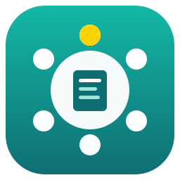
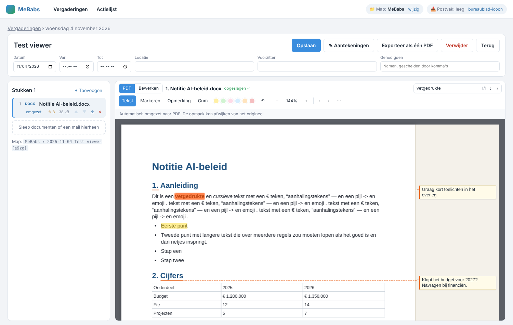
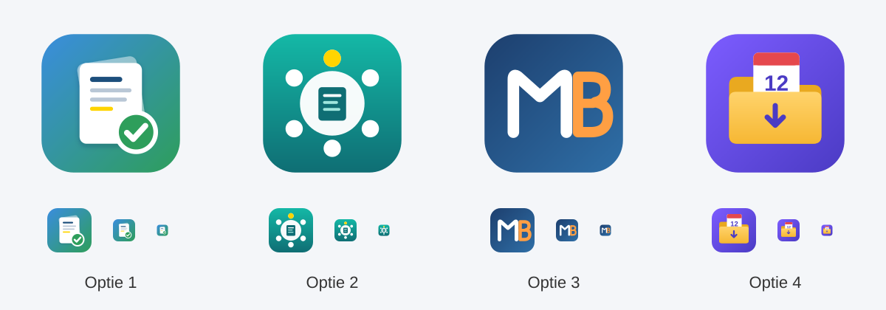
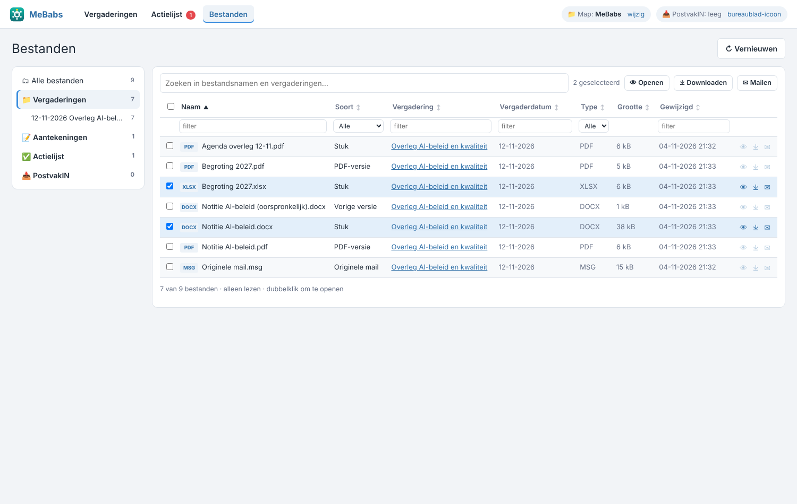

<p align="center"></p>

<h1 align="center">MeBabs</h1>

<p align="center"><b>Een lokale vergaderapp in één HTML-bestand.</b><br>
Sleep een Outlook-mail of -uitnodiging erin en je krijgt een vergadering met titel, datum, tijd, locatie, vergaderlink en alle stukken. Daarbij horen een PDF-viewer met markeren en opmerkingen, bewerken van Word, Excel en PowerPoint, aantekeningen en een actielijst.<br>
Alles blijft op je eigen computer. Er is geen server, geen installatie en geen internet nodig.</p>

---

## Inhoud

- [Wat kan MeBabs?](#wat-kan-mebabs)
- [Installatie voor gebruikers (5 minuten)](#installatie-voor-gebruikers-5-minuten)
  - [Stap 1. MeBabs downloaden](#stap-1-mebabs-downloaden)
  - [Stap 2. Een vaste plek geven](#stap-2-een-vaste-plek-geven)
  - [Stap 3. Openen in Edge](#stap-3-openen-in-edge)
  - [Stap 4. De datamap kiezen](#stap-4-de-datamap-kiezen)
  - [Stap 5. Snelkoppeling met icoon (optioneel)](#stap-5-snelkoppeling-met-icoon-optioneel)
- [Dagelijks gebruik](#dagelijks-gebruik)
- [De datamap](#de-datamap)
- [Bijwerken naar een nieuwe versie](#bijwerken-naar-een-nieuwe-versie)
- [Back-up en verhuizen](#back-up-en-verhuizen)
- [Problemen oplossen](#problemen-oplossen)
- [Privacy en beveiliging](#privacy-en-beveiliging)
- [Voor ontwikkelaars: zelf bouwen](#voor-ontwikkelaars-zelf-bouwen)
- [Projectstructuur](#projectstructuur)
- [Bekende beperkingen](#bekende-beperkingen)

---

## Wat kan MeBabs?

| | |
|---|---|
| **Mail → vergadering** | Sleep een `.msg` (Outlook) of `.eml` in het venster. MeBabs haalt de titel, datum, tijd, locatie en de **vergaderlink** (Teams, Zoom, Webex en Google Meet, ook als de link in Safe Links verpakt is) eruit en zet de bijlagen als stukken bij de vergadering. Bij een **terugkerende afspraak** krijgt de vergadering de datum en tijd van de eerstvolgende keer, met overgeslagen en verplaatste keren meegerekend. |
| **Overzicht** | Bovenaan een begroeting met het aantal vergaderingen van vandaag, en elke dag een andere wijsheid of uitspraak over leiderschap (met ↻ zie je de volgende). Daaronder de blokken **Vandaag** (met een knop *Deelnemen*) en **Morgen**, en een lijst **Volgende vergaderingen** (vanaf overmorgen) die je kunt sorteren en die standaard is ingeklapt (klik op *weergeven*). Vergaderingen die geweest zijn, staan onder een **Archief** dat je ook openklapt. De zoekbalk verschijnt zodra een van beide lijsten open is. |
| **Stukken als PDF** | Word, Excel, PowerPoint, afbeeldingen, tekst en mails worden automatisch omgezet naar PDF. PowerPoint-dia's worden getrouw weergegeven: thema en diamaster, achtergronden, vormen, afbeeldingen, tabellen, grafieken en SmartArt. Zoeken in de PDF werkt ook voor dia's. |
| **Viewer** | Je kunt zoeken in de PDF (Ctrl+F), tekst selecteren en kopiëren, **markeren** in geel of groen, en **opmerkingen** maken. Opmerkingen staan in de rechtermarge, met een pijltje naar het woord, in 9 pt. Ongedaan maken en Opnieuw werken tot 20 stappen. |
| **Bewerken** | Een bewerkomgeving voor Word (stijlen, vet, cursief, onderstrepen, uitlijnen), Excel (raster, formulebalk, formules) en PowerPoint (dia's met miniaturen). Het originele bestand blijft netjes en opent gewoon in Office. Ongedaan maken en Opnieuw werken tot 20 stappen. |
| **Exporteren** | De hele vergadering wordt één PDF: een agendapagina, daarna alle stukken met paginanummers, bladwijzers en je aantekeningen. |
| **Aantekeningen** | Een kolom om aantekeningen te maken tijdens de vergadering. Een regel die begint met `!` wordt een actie. Alles wordt opgeslagen als `jjjjmmdd Titel.txt`. |
| **Verslagen** | Alle aantekeningen op een rij, te sorteren op naam, datum en datum gewijzigd. Klik op een verslag om het te bewerken in een Word-achtige editor (koppen, vet, cursief, onderstreept, lijsten). Wijzigingen worden automatisch bewaard. |
| **Actielijst** | Alle acties met de vergaderdatum. Je kunt acties bewerken, afvinken en van de lijst halen (de regel blijft in de aantekeningen staan). Je kunt een begindatum opgeven en **snoozen** naar morgen, overmorgen, volgende week of een datum die je kiest. |
| **Bestanden** | Een verkenner met alle bestanden: zoeken, filteren per kolom, openen, downloaden, **mailen** (als conceptmail met bijlage) en naar de vergadering springen. Met **Verwijderen** haal je een bestand uit het overzicht zonder het uit de vergadering te halen. Bestanden kun je hier alleen bekijken, niet bewerken. | Hetzelfde bestand in een ander formaat of een vorige versie (PDF-versie, *(oorspronkelijk)*) staat op één regel; klik met de **rechtermuisknop** (of op *versies*) om alle versies te zien, elk met een eigen download- en mailknop. Aantekeningen, de actielijst en originele mails staan niet in dit overzicht: die vind je in de tabbladen Verslagen en Actielijst en in de vergadering zelf.

<p align="center"></p>

---

## Installatie voor gebruikers (5 minuten)

**Wat je nodig hebt:** Windows 10 of 11 met **Microsoft Edge** of **Google Chrome**, een recente versie. Je hebt geen beheerdersrechten nodig en er wordt niets geïnstalleerd.

> MeBabs werkt niet goed in Firefox of Safari. Die browsers kunnen niet met mappen op je computer werken.

### Stap 1. MeBabs downloaden

1. Ga naar de map [`dist/`](dist/) in deze repository.
2. Klik op **`MeBabs.html`** en dan rechtsboven op **Download raw file** (het pijltje naar beneden).
   Of download de hele repository: de groene knop **Code**, dan **Download ZIP**, en pak die uit.

> Alleen `MeBabs.html` heb je nodig. Alle code en bibliotheken zitten in dat ene bestand, ongeveer 2,5 MB.

### Stap 2. Een vaste plek geven

Zet `MeBabs.html` op een vaste plek, bijvoorbeeld:

```
Documenten\MeBabs\MeBabs.html
```

Maak de map **MeBabs** in **Documenten** aan als die nog niet bestaat. Op die plek kun je het bestand later ook makkelijk vervangen door een nieuwe versie.

### Stap 3. Openen in Edge

- Dubbelklik op `MeBabs.html`. Opent het bestand in een ander programma, klik dan met de rechtermuisknop en kies **Openen met** › **Microsoft Edge**.
- Maak er een favoriet van met **Ctrl+D**, of zet het in de favorietenbalk.

### Stap 4. De datamap kiezen

De eerste keer vraagt MeBabs waar de gegevens moeten komen.

1. Klik op **📁 Datamap kiezen…**. Het venster opent in **Documenten**.
2. Kies **Documenten**, of de map **MeBabs** als je die in stap 2 hebt gemaakt, en klik op **Map selecteren**.
   Kies je een map met andere bestanden erin, dan maakt MeBabs daarin zelf een submap **MeBabs** aan.
3. Edge vraagt: *"MeBabs wil wijzigingen in bestanden opslaan"*. Klik op **Wijzigingen opslaan**.

MeBabs maakt dan deze mappen aan:

```
MeBabs\
  Vergaderingen\    per vergadering een submap met de stukken
  Aantekeningen\    de aantekeningen per vergadering (jjjjmmdd Titel.txt)
  Actielijst\       Actielijst.txt
  mebabs.json       het register van MeBabs (niet zelf aanpassen)
```

> **Elke keer dat je MeBabs opent**, vraagt Edge één keer of MeBabs de map opnieuw mag gebruiken. Dat is een beveiligingsregel van de browser. Klik op **Map openen** en daarna op **Toestaan**.

> Mag je geen map kiezen, bijvoorbeeld omdat de beheerder dat heeft uitgezet? Kies dan **bewaar alles in de browser**. MeBabs werkt dan ook, maar alleen in deze browser op deze computer. Je krijgt dan geen bestanden in een map, en het bureaublad-icoon werkt niet.

### Stap 5. Snelkoppeling met icoon (optioneel)

Wil je MeBabs als een gewoon programma in een eigen venster openen, zonder adresbalk?

1. Klik met de rechtermuisknop op het bureaublad en kies **Nieuw** › **Snelkoppeling**.
2. Plak bij *Locatie van het item* het volgende. Vervang het pad door de plek waar jouw `MeBabs.html` staat, en let op de schuine strepen `/`:
   ```
   "C:\Program Files (x86)\Microsoft\Edge\Application\msedge.exe" --app="file:///C:/Users/JOUWNAAM/Documents/MeBabs/MeBabs.html"
   ```
   > Weet je het pad niet? Sleep `MeBabs.html` naar de adresbalk van Edge. Daar zie je dan het adres dat met `file:///` begint.
3. Geef de snelkoppeling de naam **MeBabs** en klik op **Voltooien**.
4. Klik met de rechtermuisknop op de snelkoppeling en kies **Eigenschappen** › **Ander pictogram…** › **Bladeren**. Kies `icons/2-tafel.ico` uit deze repository. Zet het .ico-bestand eerst in je MeBabs-map.

<p align="center"></p>

---

## Dagelijks gebruik

**Een vergadering aanmaken**
- Sleep een mail of uitnodiging uit Outlook naar het MeBabs-venster. Controleer de gegevens en klik op **Opslaan**.
- Lukt slepen niet (soms in de nieuwe Outlook)? Sleep de mail dan eerst naar je bureaublad en vandaar naar MeBabs. Of gebruik **Mail importeren…**.
- Sleep je meerdere mails tegelijk, dan maakt MeBabs ze allemaal in één keer aan.

**Weekagenda importeren**
- Klik op **📅 Importeer weekagenda** bij Vergaderingen. Daar staat ook de uitleg.
- Sla in Outlook je agenda op als `.ics`: ga naar **Agenda**, kies **Bestand › Agenda opslaan in bestand › Meer opties**, kies een datumbereik (bijvoorbeeld *Volgende 7 dagen*) en **Volledige details**.
- Kies dat bestand in MeBabs, of sleep het erin. Je ziet eerst een lijst van alle afspraken. **Vink uit wat je niet wilt** en klik op **Importeer geselecteerde**. Blokken, reistijd, uitloop en korte afspraken (tot 20 minuten) die direct naast een andere vergadering liggen, worden niet geïmporteerd. Met **⚙ Niet importeren…** pas je de trefwoorden en de minuten aan en zie je welke titels je eerder hebt uitgevinkt. Afspraken waarvan geen titel te vinden is, worden niet geïmporteerd. Wat je uitvinkt, staat de volgende keer ook uit.
- Elke aangevinkte afspraak wordt een vergadering, met datum, tijd, locatie, vergaderlink en genodigden (de organisator vooraan).
- **Bijlagen** van een afspraak worden stukken. Mails die als bijlage in de afspraak zitten (`.msg` of `.eml`), worden omgezet naar PDF. Vink daarvoor in Outlook bij **Meer opties** onder **Geavanceerd** ook **Bijlagen bij agenda-items opnemen** aan.
- Je kunt elke week opnieuw importeren. Bestaande vergaderingen worden bijgewerkt, ook als je ze eerder via een uitnodiging hebt aangemaakt. Stukken en aantekeningen blijven staan.
- Hele-dag-afspraken, geannuleerde afspraken en afspraken die al geweest zijn, worden overgeslagen. Een afspraak die je in Outlook verwijdert, blijft in MeBabs staan.
- **Sneltoets zonder macro:** voeg via **Bestand › Opties › Werkbalk Snelle toegang** de opdracht **Opslaan als agenda** toe (kies *Alle opdrachten*). In de agenda opent **Alt + het cijfer van die knop** dan meteen het venster om de agenda op te slaan.
- **Sneltoets met macro (optioneel):** de macro in [`outlook/MeBabs-weekagenda.bas`](outlook/MeBabs-weekagenda.bas) slaat met één klik de komende 7 dagen op in je map Downloads. Op de importpagina staat hoe je hem instelt, met een knop om de code te kopiëren. Dit werkt alleen in de klassieke Outlook voor Windows en alleen als je organisatie macro's toestaat.

**Genodigden**
- Vul de namen in, gescheiden door komma's. De **eerste naam is de voorzitter**.

**Vergaderingen verwijderen**
- Open een vergadering en klik op **Verwijder**, of vink in de lijst bij Vergaderingen meerdere vergaderingen aan en klik op **🗑 Verwijderen** in de balk die onderaan verschijnt.
- Bij verwijderen uit de lijst wordt alles gewist wat bij de vergadering hoort: de map met stukken, de originele mail, gewijzigde versies, de aantekeningen en de acties.

**Stukken**
- Sleep documenten op een geopende vergadering.
- Met ▲▼ bepaal je de volgorde, die ook geldt voor de export.
- Sleep je een bestand met **dezelfde naam** op de vergadering, dan vraagt MeBabs of het de oude versie moet vervangen. Zo werk je een stuk bij dat je in Word zelf hebt aangepast.

**Viewer**

| Knop | Wat het doet |
|---|---|
| **Tekst** | Tekst selecteren en kopiëren (Ctrl+C). |
| **Markeren** | Selecteer tekst; die wordt gemarkeerd in geel of groen. |
| **Opmerking** | Klik op een woord en typ. De opmerking komt in de rechtermarge. Ctrl+Enter = klaar. |
| **Gum** | Klik op een markering of opmerking om die te verwijderen. |
| ↶ ↷ | Ongedaan maken en opnieuw, tot 20 stappen (Ctrl+Z en Ctrl+Y). |
| Zoekvak | Zoeken in de PDF (Ctrl+F), daarna Enter voor de volgende treffer. |
| − 100% + | Kleiner en groter. Ingezoomd kun je met de horizontale schuifbalk de hele pagina zien. Klik op het percentage om de pagina weer passend te maken. |
| ⛶ | De viewer tijdelijk vergroten tot het hele browservenster. Nog een keer klikken of Esc maakt hem weer klein. Werkt ook bij Bewerken. |
| ⋯ | Het stuk downloaden met je aantekeningen, of het origineel downloaden. |

**Bewerken** (tabblad boven de viewer)
- Word: stijlen, **B** *I* U, opsomming en uitlijnen.
- Excel: typ in een cel. Met Enter, Tab en de pijltjes beweeg je, met F2 pas je een cel aan, met Delete wis je hem, en met `=` begin je een formule.
- PowerPoint: de dia's zien er hetzelfde uit als in de PDF. Klik in een tekstvak op de dia om de tekst aan te passen.
- Opslaan doe je met **💾 Opslaan** of **Ctrl+S**. De eerste keer bewaart MeBabs een kopie `(oorspronkelijk)` en daarna wordt de PDF bijgewerkt.

**Aantekeningen en acties**
- Klik op **✎ Aantekeningen** voor de kolom rechts. Een regel die met `!` begint, wordt een actie, bijvoorbeeld `! Jan stuurt de notitie rond`.
- In het tabblad **Actielijst** kun je acties bewerken, afvinken, ⏰ snoozen, een begindatum geven en van de lijst halen. Wat je van de lijst haalt, staat onder *Verwijderd* en kun je terugzetten.

**Exporteren**
- **Exporteer als één PDF** maakt `Titel - dd-mm-jjjj uu.mm-uu.mm.pdf`. Het bestand komt in Downloads en in de map van de vergadering.

**Bestanden**
- Hier zie je alle bestanden uit de datamap. Je kunt ze openen, downloaden, ✉ mailen en met **Vergadering ›** naar de bijbehorende vergadering gaan.
- Mailen maakt een conceptmail (`.eml`) met de bijlagen. Open het gedownloade bestand en Outlook start een nieuwe mail die klaar is om te versturen.
- **🗑 Verwijderen** haalt een bestand alleen uit dit overzicht. In de vergadering en in de datamap blijft het gewoon staan. Met **Verwijderd tonen** zie je wat je hebt weggehaald, en met **↩ Terugzetten** komt het terug in het overzicht.

<p align="center"></p>

---

## De datamap

| Map of bestand | Inhoud |
|---|---|
| `Vergaderingen\2026-11-12 Titel [ab12]\` | De originele stukken, de PDF-versies, `(oorspronkelijk)`-kopieën, de originele mail en exports. |
| `Aantekeningen\20261112 Titel.txt` | Kop met datum, locatie, voorzitter en leden, daarna je aantekeningen en acties. |
| `Actielijst\Actielijst.txt` | Alle acties, ingedeeld in open, gesnoozed en afgerond. |
| `mebabs.json` | Het register: vergaderingen, aantekeningen, markeringen en acties. **Niet met de hand aanpassen.** |

Elke vergadering heeft een eigen map in `Vergaderingen\`, ook als er nog geen stukken in zitten (bijvoorbeeld na het importeren van je weekagenda).

Verwijder je een vergadering in MeBabs, dan wordt de hele map in `Vergaderingen\` gewist: de stukken, de originele mail en alle gewijzigde versies. Je aantekeningen in `Aantekeningen\` blijven staan. Verwijder je vergaderingen via de lijst (aanvinken en **Verwijderen**), dan worden ook de aantekeningen gewist.

Je kunt bestanden in deze mappen gewoon openen en kopiëren. Hernoem of verwijder bestanden in `Vergaderingen\` liever niet buiten MeBabs om, want dan klopt het register niet meer.

> Gebruikte je een oudere versie, waarin alles los in de hoofdmap stond? Dan zet MeBabs je bestaande gegevens de eerste keer vanzelf in de nieuwe indeling.

---

## Bijwerken naar een nieuwe versie

1. Download de nieuwe `dist/MeBabs.html`.
2. Vervang je oude `MeBabs.html` door het nieuwe bestand, met dezelfde naam op dezelfde plek.
3. Open MeBabs en kies dezelfde datamap. Al je vergaderingen staan er weer.

Je gegevens staan in de datamap, niet in het HTML-bestand. Vervangen is dus veilig.

## Back-up en verhuizen

- **Back-up:** kopieer de hele map `MeBabs`, bijvoorbeeld naar OneDrive of een netwerkschijf.
- **Naar een andere computer:** kopieer de map, open `MeBabs.html` en kies via **wijzig** bovenin de gekopieerde map.

---

## Problemen oplossen

| Probleem | Oplossing |
|---|---|
| **Er gebeurt niets als ik een mail sleep** | Sleep de mail eerst naar het bureaublad en daarna naar MeBabs. Of gebruik **Mail importeren…**. |
| **"Map kiezen lukt niet"** | Je beheerder heeft toegang tot mappen misschien geblokkeerd. Kies **bewaar alles in de browser**. |
| **Edge vraagt elke keer om toegang** | Dat is normaal, het is een beveiligingsregel van de browser. Klik op **Map openen** en dan op **Toestaan**. |
| **Een stuk heeft het label "geen PDF"** | Oude formaten (`.doc`, `.xls`, `.ppt`) kunnen niet worden omgezet. Open het bestand in Word of Excel, kies **Opslaan als** › **PDF** en sleep de PDF op de vergadering. MeBabs vraagt dan of die PDF als versie van het stuk moet dienen. |
| **De opmaak van een omgezet stuk wijkt af** | Het omzetten gebeurt zonder Word, dus de tekst klopt maar de opmaak is vereenvoudigd. Gebruik voor de exacte opmaak de PDF-route hierboven. |
| **Een gescande PDF: zoeken en markeren werkt niet** | Een scan is een afbeelding zonder tekst. Opmerkingen werken wel. |
| **De viewer blijft leeg** | Kies in ⋯ voor **PDF openen in nieuw tabblad**. |
| **De conceptmail opent als gewone mail** | Dat gebeurt in de nieuwe Outlook. Download de bestanden dan met ⤓ en sleep ze in een nieuwe mail. |
| **Ik zie mijn vergaderingen niet meer** | Kies bovenin via **wijzig** de juiste datamap. Kijk ook in het **Archief** onderaan de beginpagina. |

---

## Privacy en beveiliging

- MeBabs draait volledig **in je eigen browser**. Mails, stukken en aantekeningen worden **nergens naartoe gestuurd**.
- Er worden geen externe scripts of lettertypen geladen. Alles zit in het HTML-bestand, dus MeBabs werkt ook zonder internet.
- MeBabs heeft alleen toegang tot de ene datamap die jij kiest, en alleen nadat jij in Edge toestemming hebt gegeven.

---

## Voor ontwikkelaars: zelf bouwen

**Vereisten:** [Node.js](https://nodejs.org/) 18 of nieuwer.

```bash
git clone https://github.com/<account>/mebabs.git
cd mebabs
npm install
npm run build        # maakt dist/MeBabs.html
```

`scripts/build.js` voegt alles samen tot één HTML-bestand:

1. de broncode uit `src/` (in een vaste volgorde, als één IIFE);
2. **pdf-lib** (PDF maken en samenvoegen) en **JSZip** (Office-bestanden lezen en schrijven);
3. **pdf.js**: de viewer, de tekstlaag en zoeken. Dit wordt met esbuild omgezet van ES-module naar een klassiek script, zodat het ook vanaf `file://` werkt;
4. het icoon `src/icon.svg`, als favicon en logo;
5. de Outlook-macro `outlook/MeBabs-weekagenda.bas`, zodat gebruikers die op de importpagina kunnen kopiëren.

**Testen tijdens het ontwikkelen:** open `dist/MeBabs.html` in Edge of Chrome. Wil je de testhaken gebruiken, zet dan `window.__VA_TEST = 1` voordat het script laadt, bijvoorbeeld via Playwright `addInitScript`. Dan zijn interne functies beschikbaar onder `window.__va`.

### Projectstructuur

```
mebabs/
├─ dist/
│  └─ MeBabs.html        ← het gebouwde bestand (dit gebruiken)
├─ src/
│  ├─ app.html           ← HTML-sjabloon en alle CSS
│  ├─ mail-parser.js     ← .msg (CFB/OLE) en .eml (MIME) lezen; datum/tijd/locatie/link herkennen
│  ├─ convert.js         ← omzetten naar PDF (Word/Excel/tekst/afbeelding), aantekeningen
│  ├─ pptx-render.js     ← PowerPoint-dia's getrouw tekenen (voor de PDF en de bewerkomgeving)
│  │                       in de PDF zetten, vergadering exporteren als één PDF
│  ├─ editor.js          ← bewerkomgevingen Word/Excel/PowerPoint/tekst met ongedaan maken en opnieuw
│  ├─ notes.js           ← aantekeningen tijdens de vergadering en de actielijst (snooze, begindatum)
│  ├─ reports.js         ← tabblad Verslagen (lijst en Word-achtige editor)
│  ├─ files.js           ← tabblad Bestanden (alleen lezen, zoeken, filteren, mailen)
│  ├─ app-ui.js          ← opslag (map / IndexedDB), routes, overzicht, vergaderpagina,
│  │                       PDF-viewer met markeren/opmerkingen/zoeken
│  └─ icon.svg           ← app-icoon (optie 2, Tafel)
├─ outlook/
│  └─ MeBabs-weekagenda.bas ← Outlook-macro: agenda van de komende 7 dagen opslaan als .ics
├─ icons/                ← vier icoonontwerpen als SVG, PNG en ICO
├─ docs/                 ← schermafbeeldingen voor deze README
├─ scripts/build.js      ← bouwscript
└─ package.json
```

**Gebruikte techniek:** gewone JavaScript zonder framework, de File System Access API (`showDirectoryPicker`), IndexedDB voor de mapkoppeling en als reserveopslag, pdf.js, pdf-lib en JSZip.

---

## Bekende beperkingen

- **Alleen Edge of Chrome**, vanwege de File System Access API.
- **Omzetten naar PDF gebeurt zonder Office:** bij Word en Excel is de opmaak vereenvoudigd. Oude formaten (`.doc`, `.xls`, `.ppt`) worden niet omgezet.
- **PowerPoint:** dia's worden als afbeelding in de PDF gezet, met de tekst er onzichtbaar overheen (zodat zoeken werkt). Grafieken worden eenvoudig nagetekend (staaf, lijn, vlak, cirkel, ring); andere soorten grafieken, 3D-effecten, schaduwen, animaties en afbeeldingen in EMF/WMF-formaat worden niet of vereenvoudigd getoond. Lettertypen die niet op je computer staan, worden vervangen. Verborgen dia's komen niet in de PDF.
- **Oudere PowerPoint-stukken** worden de eerste keer dat je ze opent opnieuw omgezet met de nieuwe weergave, behalve als je er al aantekeningen op hebt gezet. Dan blijft de oude PDF staan; sleep het bestand opnieuw op de vergadering voor de nieuwe weergave.
- **Bewerken:** in Word kun je geen afbeeldingen of tabellen invoegen, en alinea's met een afbeelding kun je niet bewerken. In Excel kun je de opmaak van cellen niet veranderen. In PowerPoint kun je geen vormen of dia's toevoegen. Voor zulke dingen download je het bestand en bewerk je het in Office zelf.
- **Mappen openen in Verkenner** vanuit MeBabs kan niet, want een browser mag dat niet. Open de map zelf via Verkenner.
- **Toestemming:** Edge vraagt bij elke start één keer of MeBabs de map opnieuw mag gebruiken.
